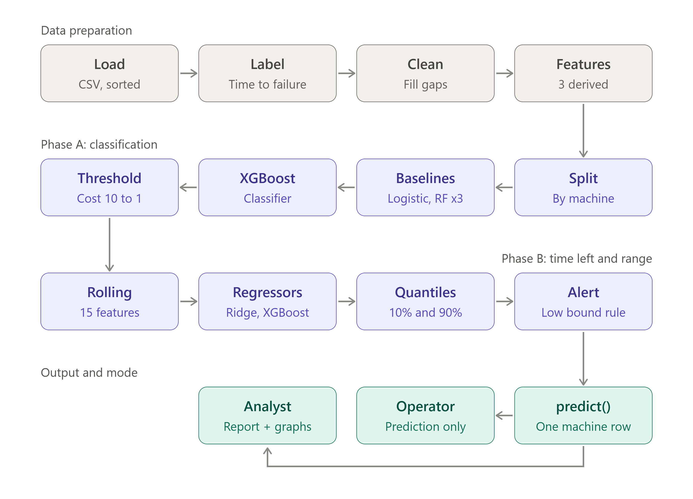

# PredictIQ

[](https://www.python.org/)
[](https://pandas.pydata.org/)
[](https://scikit-learn.org/)
[](https://xgboost.readthedocs.io/)
[](#important-limitations)
[](#license)

PredictIQ is an end-to-end predictive-maintenance demonstration built from factory sensor readings. Given the latest operating conditions of a machine, it estimates:

1. whether the machine is likely to fail within a user-chosen number of hours;
2. the remaining useful life (RUL), expressed as time to the next failure; and
3. an uncertainty interval around that RUL estimate, so maintenance decisions can be made conservatively.

The project deliberately uses a simulated factory dataset. It demonstrates the full machine-learning workflow--data preparation, leakage-aware evaluation, classification, regression, uncertainty estimation, alerting, and interpretability--rather than claim production-ready performance on real equipment.



## Contents

- [What the project solves](#what-the-project-solves)
- [Repository layout](#repository-layout)
- [Requirements and setup](#requirements-and-setup)
- [Run the project](#run-the-project)
- [Dataset](#dataset)
- [How the pipeline works](#how-the-pipeline-works)
- [Outputs](#outputs)
- [Evaluation results](#evaluation-results)
- [Generate a new dataset](#generate-a-new-dataset)
- [Important limitations](#important-limitations)

## What the project solves

Industrial machines generate temperature, vibration, pressure, rotation speed, and power measurements continuously. A useful maintenance system must turn those measurements into an actionable answer, not merely label a machine as normal or failed.

PredictIQ frames the problem in three complementary ways:

| Task | Target | Why it matters |
| --- | --- | --- |
| Failure classification | `fail_within_N`: will the next failure occur within `N` hours? | Supports a clear maintenance alert. |
| RUL regression | `ttf_sec`: seconds until the next failure | Helps plan when maintenance should happen. |
| Quantile regression | 10th and 90th RUL percentiles | Communicates uncertainty instead of presenting one estimate as certain. |

The alert rule uses the lower (pessimistic) end of the RUL interval. This favors catching failures when a missed failure is assumed to cost ten times as much as a false alert.

## Repository layout

```text
PredictIQ/
├── main.py.py                         # Training, evaluation, charts, and sample predictions
├── README.md
├── Data/
│   ├── Dataset/
│   │   ├── factory_sim_hard.csv       # Main simulated dataset used by the project
│   │   └── factory_sim.csv            # Earlier/simpler dataset variant
│   └── Dataset_Genrator/
│       ├── make_factory_sim_hard.py   # Generator for the main, noisier simulation
│       └── data_genrator.py           # Generator for the earlier simulation
├── doc/                               # Pipeline image and HTML technical guides
└── diff versions/                     # Historical iterations of the training script
```

> The filenames reflect the project as it currently stands, including `main.py.py` and `Dataset_Genrator`. Rename them only if you also update every dependent reference.

## Requirements and setup

Use Python 3.10 or newer. The project does not currently include a `requirements.txt`, so install the packages below in an isolated environment.

```powershell
python -m venv .venv
.\.venv\Scripts\Activate.ps1
python -m pip install --upgrade pip
python -m pip install pandas numpy scikit-learn xgboost imbalanced-learn matplotlib seaborn shap
```

On macOS/Linux, activate the environment with:

```bash
source .venv/bin/activate
```

## Run the project

From the repository root, run:

```powershell
python .\main.py.py
```

The script asks for two inputs:

1. **Prediction horizon (`N`)** -- the number of hours used to label an upcoming failure. For example, enter `1` to ask, “Will this machine fail in the next hour?”
2. **Output mode** -- choose `1` for a concise operator-oriented output or `2` for the full analyst report, metrics, and charts.

### Dataset-path note

The committed dataset is located at `Data/Dataset/factory_sim_hard.csv`, while the current script constructs a path to `Data/factory_sim_hard.csv`. Before running, change the `dp` assignment near the top of `main.py.py` to:

```python
dp = os.path.join(
    os.path.dirname(os.path.abspath(__file__)),
    "Data", "Dataset", "factory_sim_hard.csv"
)
```

This is a path correction only; it does not change the model or data.

## Dataset

`factory_sim_hard.csv` represents 20 heterogeneous machines measured at nominal 10-second intervals. It contains roughly 345,600 observations (20 machines x 17,280 readings), with multiple failure-and-maintenance cycles per machine.

The simulator adds operational telemetry complications: sensor noise, drift, missing readings, dropped packets, stuck sensors, outliers, random health shocks, and imperfect repair events. A hidden health score drives deterioration, but the model never receives that score as a feature.

| Column | Description | Used by the model? |
| --- | --- | --- |
| `machineID` | Unique machine identifier | Only for grouping/splitting and rolling calculations |
| `t_sec` | Simulated timestamp in seconds | Only to construct time-to-failure labels |
| `temp`, `vib`, `pressure`, `rotation`, `power` | Observable sensor readings | Yes |
| `op_hours` | Cumulative operating hours | Yes |
| `n_maint` | Count of completed maintenance events | Yes |
| `hours_since_maint` | Operating hours since last maintenance | Yes |
| `_health_hidden` | Simulator-only internal health state | No; explicitly removed before training |
| `fail_event` | Whether this record is a failure event | Used only to build labels |

### Labels and censored data

For every row, the pipeline finds the next `fail_event` belonging to the same machine and calculates:

```text
ttf_sec = next failure timestamp - current timestamp
```

Rows after a machine’s final observed failure have no known next-failure time. They are **right-censored**, so the script removes them rather than treating their RUL as known. The classification label is then:

```text
fail_within_N = 1 if ttf_sec <= N x 3,600 else 0
```

## How the pipeline works

### 1. Clean and engineer features

Missing sensor values are forward-filled within each machine; leading gaps are then back-filled. The model starts with the raw observable inputs and adds these engineered features:

| Feature | Formula | Intuition |
| --- | --- | --- |
| `power_per_rpm` | `power / rotation` | Energy use relative to rotation speed |
| `temp_x_vib` | `temp x vib` | Captures joint heat-and-vibration deterioration |
| `maint_load` | `hours_since_maint x power` | Sustained load since the latest maintenance |

For the Phase B models, it also adds per-machine rolling features over 30 readings (about five minutes at the nominal cadence): rolling mean, rolling standard deviation, and a 30-reading difference/trend for every sensor. These features represent recent behavior rather than a single sensor snapshot.

### 2. Split by machine, not by row

The data is divided using `GroupShuffleSplit`, with `machineID` as the group. Approximately 75% of machines are used for training and 25% for testing.

This is essential: adjacent readings from one machine are extremely similar. A random row split would place near-duplicate observations in both sets and make the score unrealistically optimistic. A machine-level split instead tests whether the model transfers to unseen machines.

### 3. Train failure classifiers

The script compares several approaches:

- Logistic Regression with standardized features and balanced class weights;
- XGBoost classifier with a positive-class weight based on the training distribution;
- Random Forest with no imbalance handling, balanced class weights, and SMOTE oversampling; and
- a second XGBoost classifier that includes the rolling Phase B features.

Performance is measured primarily with **PR-AUC** (average precision), which is more informative than raw accuracy when imminent failures are comparatively rare.

### 4. Train RUL regressors

A Ridge regression model serves as a linear baseline. The principal model is an XGBoost regressor trained to predict `ttf_sec`. Predictions are clipped at zero because negative remaining life is not meaningful.

The regression evaluation reports **RMSE** (which penalizes larger timing errors more strongly), **MAE** (typical absolute timing error), and improvement over the Ridge baseline.

### 5. Quantify uncertainty and choose alerts

Two additional XGBoost regressors learn the 10th and 90th percentiles of time-to-failure using quantile loss. Together, they create an 80% prediction interval:

```text
lower RUL estimate <= actual RUL <= upper RUL estimate
```

The script checks empirical interval coverage; a well-calibrated 10–90% interval should cover roughly 80% of test cases. An alert fires when the lower bound is inside the selected horizon. This conservative rule asks, “Could the machine fail soon even in a relatively optimistic reading of the uncertainty?”

The classifier threshold is also selected with a cost sweep from 0.05 to 0.94. The chosen threshold minimizes:

```text
total cost = 10 x false negatives + 1 x false positives
```

### 6. Explain model behavior

SHAP summary plots are generated for the snapshot classifier and RUL regressor. They show globally important features and how lower/higher feature values influence individual predictions.

## Outputs

In **Operator** mode, the final section shows sample predictions in a format similar to:

```text
Fails within 1h? No (10.0%).
Time Left ~01:18:03,
Range 01:12:02-01:44:01.
```

In **Analyst** mode, the script additionally logs data-quality checks, train/test machine IDs, classification reports, PR-AUC and ROC-AUC, imbalance experiments, cost-optimal threshold, regression metrics, interval coverage, and alert counts. It displays six visualizations:

1. XGBoost confusion matrix;
2. precision-recall curve;
3. classifier global SHAP importance;
4. classifier SHAP summary plot;
5. RUL regressor global SHAP importance; and
6. RUL regressor SHAP summary plot.

## Evaluation results

The following figures are the documented holdout results for a one-hour horizon. They are useful as a project baseline, not as evidence of real-world plant performance.

| Model / check | Result |
| --- | ---: |
| Test-set failure rate | 11.8% |
| Logistic Regression PR-AUC | 99.1% |
| XGBoost snapshot classifier PR-AUC | 99.3% |
| XGBoost classifier with rolling features PR-AUC | 99.9% |
| Ridge RUL RMSE / MAE | 1.00 h / 0.73 h |
| XGBoost RUL RMSE / MAE | 0.32 h / 0.19 h |
| XGBoost RUL RMSE improvement vs. Ridge | 67.5% lower |
| 10–90% interval coverage | 79.4% |
| Pessimistic-bound alert recall | 8,981 / 9,025 (99.5%) |
| False alarms at the one-hour alert horizon | 612 |

With a 10:1 false-negative:false-positive cost ratio, the documented optimal classifier threshold is 0.24. Its total cost was 1,920, compared with 2,239 at the default 0.50 threshold.

These scores are high because the simulation contains learnable degradation patterns. They should not be treated as a forecast of performance with real sensor installations.

## Generate a new dataset

To create another noisy factory simulation, run the generator from the directory where you want its CSV output:

```powershell
python .\Data\Dataset_Genrator\make_factory_sim_hard.py
```

The generator writes `factory_sim_hard.csv` to the current working directory. Move the new file into `Data/Dataset/` (or update `dp` to point to it) before training. It uses a fixed random seed (`7`), so unchanged code produces the same dataset.

## Important limitations

- **Simulated data:** Sensor relationships and failure modes are authored by the simulator. Real failures may have different causes, changing operating regimes, poor labels, drift, and unobserved confounders.
- **Small group holdout:** Only a small number of machines are held out, so reported metrics can vary with the selected machine split.
- **Within-machine rolling features:** Rolling calculations use preceding readings from the same complete time series. A deployment version should preserve per-machine state and compute features only from readings available at prediction time.
- **No production packaging:** The project is an exploratory script, not a deployed service. It does not persist models, validate incoming schemas, monitor drift, authenticate users, or expose an API.
- **Maintenance cost assumptions:** The 10:1 cost ratio is a project assumption. In practice, it should be set with maintenance, operations, safety, and finance stakeholders.

## Further documentation

For a visual walkthrough, open [PredictIQ Explained](doc/PredictIQ_Explained.html). For a phase-by-phase implementation description, open [Complete Technical Reference](doc/PredictIQ_%20Complete%20Technical%20Reference%20(v3).html).

## Technology

Python, pandas, NumPy, scikit-learn, XGBoost, imbalanced-learn, SHAP, Matplotlib, and Seaborn.

## License

No license has been specified for this repository yet. Add a license file before redistributing or reusing the project outside its intended context.
